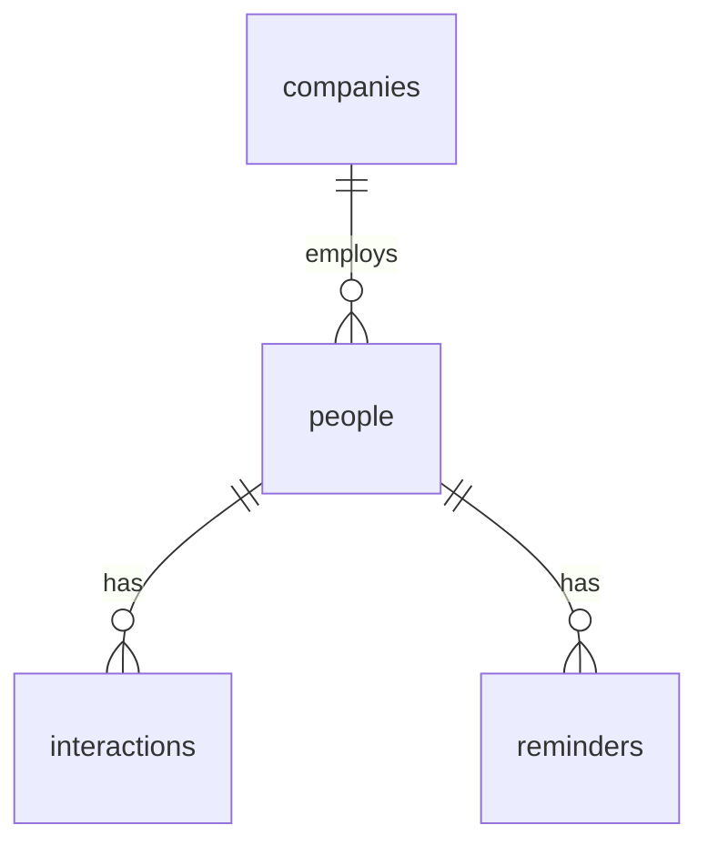

# PLAN.md: Recruiting Tracker

## 1. Pitch
I'm building a recruiting tracker because my target companies, contacts, coffee chats, and follow-ups are spread across two spreadsheets and I keep losing track of who to follow up with. I'll use it several times a week during MBA recruiting (through May 2027).

## 2. Features (user stories, in build order)
0. Spine: As a user, I want to sign up and log in, so that my contacts are private to me.
1. As a recruiter-in-training, I want to add a company with name, website, description, and source, so that I keep one target list.
2. As a user, I want to see all companies in a searchable list, so that I can find one quickly.
3. As a user, I want to add a person with name, email, title, company, how we met, and tags, so that I know who I know at each company.
4. As a user, I want to open a company and see its people, so that I know who to reach out to there.
5. As a user, I want to log an interaction (date, source, summary) on a person, so that I remember what we talked about.
6. As a user, I want to set a status on a company (Researching, Reaching out, Applied, Interviewing, Offer, Closed), so that I can see my pipeline.
7. As a user, I want to add a reminder with a due date to a person and mark it done, so that no follow-up slips.
8. As a user, I want a "Due this week" dashboard of open reminders, so that I start each week knowing my follow-ups.
9. As a user, I want to import companies from a CSV file upload, so that I can load my existing spreadsheet instead of retyping it.

## 3. Database
**companies**: id (number, PK), user_id (text, FK to auth user), name (text), website (text), description (text), source (text), status (text), created_at (date)
**people**: id (number, PK), user_id (text), company_id (number, FK to companies), name (text), email (text), email_verified (true/false), title (text), how_met (text), tags (text), follow_up_date (date)
**interactions**: id (number, PK), person_id (number, FK to people), date (date), source (text: email, linkedin, in-person, zoom), summary (text)
**reminders**: id (number, PK), person_id (number, FK to people), due_date (date), note (text), done (true/false)

Relationships: one company has many people; one person has many interactions; one person has many reminders.

### Import rules (from my two sheets)
- Seed companies from the "Companies to Track" main tab and the "AI Safety Orgs" tab; keep its status values.
- Drop newsletter, job-alert, and notification rows from the contacts People tab (keep only the ~30 real people).
- Any email marked "guessed" imports with email_verified = false.
- Phone numbers and private notes never go in the repo or the seed file. Seed data in a public repo uses only names, companies, titles, and how-met.

## 4. Tests
1. Given I am logged in, when I add a company named "Anthropic", then it appears in my company list.
2. Given a person with one open reminder due tomorrow, when I mark it done, then it disappears from "Due this week".

## 5. Technologies
- Coding agent: Claude Code. I already use it and it works well branch by branch.
- Database and auth: Supabase (Postgres plus email login). Gives real tables, foreign keys, and sign-up in one service.
- Frontend: Next.js. Supabase and Vercel both support it well.
- Hosting: Vercel. Deploys every merge to main automatically.
- Libraries: Papa Parse for the CSV import; Vitest for tests.

## 6. Design
Clean and calm: white background, Berkeley blue (#003262) accents, gold (#FDB515) for status badges. Borrow from Linear (dense lists, keyboard-friendly) and Notion (simple cards).

## 7. Risks and cuts
- Least sure: the CSV import (messy columns). Cut first if out of time: the CSV import (#9), then the dashboard (#8).

## Build order (one PR each, issue to branch to PR with "closes #N")
1. PLAN.md (this file)
2. feature/auth
3. feature/add-company
4. feature/company-list
5. feature/people
6. feature/company-detail
7. feature/interactions
8. feature/status
9. feature/reminders
10. feature/dashboard
11. feature/csv-import

Save key prompts in prompts/<feature>.md on each branch and deploy after each merge.

## Plan vs. Reality
(Fill in at the end.)

| Planned feature | Shipped / Changed / Cut | Status (Done/Backlogged) | Learning | What changed and why |
|---|---|---|---|---|
