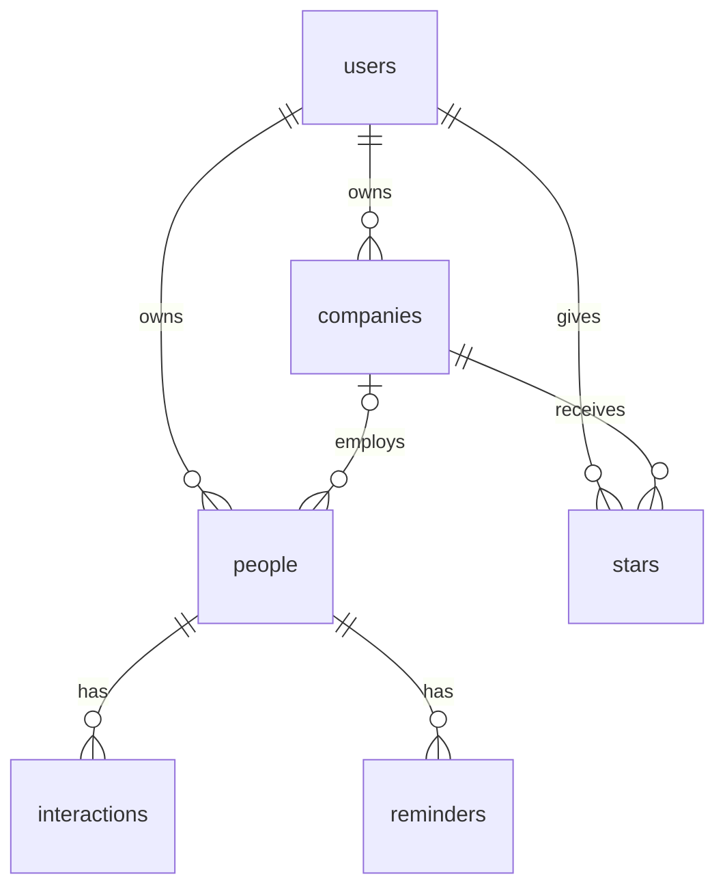

# PLAN.md: Recruiting Tracker

## 1. Pitch
I'm building a recruiting tracker because my target companies, contacts, coffee chats, and follow-ups are spread across two spreadsheets and I keep losing track of who to follow up with. I'll use it several times a week during MBA recruiting (through May 2027).

## 2. Features (user stories, in build order)
1. [Spine 1] As a user, I want to sign up and log in, so that I see only my own companies, contacts, and follow-ups.
2. [Spine 2] As a user, I want my account, companies, and people stored in related tables, so that a company can have many contacts and each account stays separate.
3. [Spine 3] As a recruiter-in-training, I want to add a company (name, website, description, source, and status), open its detail page, edit it, and delete it only after an "are you sure?" check, so that I keep one target list.
4. [Spine 4] As a user, I want a friendly message when a required field is blank, so that I can't save a company with no name.
5. [Spine 5] As a user, I want to star a company and see a starred view, so that my top targets stay one click away. Every star is one row in a single stars table: this user starred this company.
6. [Spine 6] As a user, I want to search or filter the company list, including by status, and sort it, so that I can find one quickly.
7. [Spine 7] As a user, I want a dashboard with one chart and two or three summary stats, so that I can see my pipeline at a glance.
8. [My feature 1] As a user, I want to add a person (name, email, title, company, how we met, tags) on a company and log an interaction (date, source, summary), so that I remember who I know there and what we talked about.
9. [My feature 2] As a user, I want to add a reminder with a due date on a person, mark it done, and see what's due this week, so that no follow-up slips.
10. [My feature 3] As a user, I want to import companies from a CSV file upload, so that I can load my existing spreadsheet instead of retyping it.
11. [Stretch] As a user, I want a status pipeline board (Researching through Closed), so that I can see every company by stage. Filtering by status in Spine 6 covers this if I run out of time.

## 3. Database
**users**: id (text, PK, same id as Supabase auth.users), email (text), created_at (date). This is my users table, one row per account, mirroring auth.users.
**companies**: id (number, PK), user_id (text, FK to users), name (text), website (text), description (text), source (text), status (text), created_at (date)
**people**: id (number, PK), user_id (text, FK to users), company_id (number, FK to companies, nullable — a person doesn't need a company), name (text), email (text), email_verified (true/false), title (text), how_met (text), tags (text, comma-separated), follow_up_date (date)
**interactions**: id (number, PK), person_id (number, FK to people), date (date), source (text: email, linkedin, in-person, zoom), summary (text)
**reminders**: id (number, PK), person_id (number, FK to people), due_date (date), note (text), done (true/false)
**stars**: id (number, PK), user_id (text, FK to users), company_id (number, FK to companies), created_at (date). Unique on (user_id, company_id). One table for everyone, not one per user.

Allowed `status` values: Researching, Reaching out, Applied, Interviewing, Offer, Closed.

Relationships: one user has many companies, people, and stars; one company has many people (and `people.company_id` can be empty); one person has many interactions; one person has many reminders; stars is the many-to-many link between a user and a company.

### Import rules (from my two sheets)
- Seed companies from the "Companies to Track" main tab and the "AI Safety Orgs" tab; keep its status values.
- Drop newsletter, job-alert, and notification rows from the contacts People tab (keep only the ~30 real people).
- Any email marked "guessed" imports with email_verified = false.
- Phone numbers and private notes never go in the repo or the seed file. Seed data in a public repo uses only names, companies, titles, and how-met.

## 4. Tests
1. Data isolation: Given User A has a company and User B is logged in, when B views the company list, then A's company is not shown.
2. Dashboard stat: Given 3 companies, 1 with status Applied, when the dashboard loads, then the "Applied" count shows 1.

## 5. Technologies
- Coding agent: Claude Code. I already use it and it works well branch by branch.
- Database and auth: Supabase (Postgres plus email login). Gives real tables, foreign keys, and sign-up in one service.
- Sign up and login: New visitors create an account in the app with Supabase email and password, log in and out, and row-level security means each user sees only their own rows.
- Frontend: Next.js. Supabase and Vercel both support it well.
- Hosting: Vercel. Deploys every merge to main automatically.
- Libraries: Papa Parse for the CSV import; Vitest for tests.

## 6. Design
Clean and calm: white background, Berkeley blue (#003262) accents, gold (#FDB515) for status badges. Layout: a sidebar list of companies with a detail pane. Borrow from Linear (dense lists, keyboard-friendly), Notion (simple cards), and Huntr (a recruiting pipeline with status and follow-ups).

## 7. Risks and cuts
- Least sure: the CSV import (messy columns). Cut first if I run out of time: CSV import (My feature 3), then the stretch pipeline board. I won't cut a spine feature. The dashboard stays.

## Build order (one PR each, issue to branch to PR with "closes #N")
1. PLAN.md (this file)
2. feature/auth — Spine 1
3. feature/data-model — Spine 2
4. feature/companies — Spine 3
5. feature/validation — Spine 4
6. feature/stars — Spine 5
7. feature/find — Spine 6
8. feature/dashboard — Spine 7
9. feature/interactions — My feature 1
10. feature/reminders — My feature 2
11. feature/csv-import — My feature 3
12. feature/pipeline — Stretch, only if the spine and my 3 are done

Save key prompts in prompts/<feature>.md on each branch and deploy after each merge.

## Plan vs. Reality

| Planned feature | Shipped / Changed / Cut | Status (Done/Backlogged) | Learning | What changed and why |
|---|---|---|---|---|
| PR #2, PLAN.md | Shipped | Done | Writing the plan before any feature PR made the later issues concrete. | Added PLAN.md at the root and a one-line README description. That first draft was not yet labeled with the spine. |
| PR #4, spine alignment | Changed | Done | The brief's 7 spine features and 2 tests were not in the first plan. | Renumbered the stories as Spine 1–7, My feature 1–3, and Stretch. Added users, stars, nullable people.company_id, comma-separated tags, the six statuses, schema.md, and the data-isolation and Applied-count tests. Left this table empty on purpose. The design's sidebar-and-detail-pane layout was never built; later PRs used separate pages. The status pipeline board stayed stretch and was not built. |
| PR #6, Spine 1 sign up and login | Shipped, changed | Done | Next.js 16 calls the route guard proxy.ts, not middleware.ts. Spine 2's tables shipped in this PR instead of their own. | Email and password sign up, log in, and log out. 0001_init.sql creates users (uuid mirroring auth.users, not text), companies, people, interactions, reminders, and stars, with user_id = auth.uid(). A trigger inserts the profile row. The data-isolation test skips until Supabase env vars are set. |
| PR #8, Spine 3 company CRUD | Shipped, changed | Done | I had a separate applications pipeline in mind, but schema.md has no applications table. A company row is the application, and it carries the pipeline status. | Delete asks "Are you sure?" before the row is removed. List, detail, create, edit, and delete all run as the logged-in user, so RLS (user_id = auth.uid()) shows only my companies. |
| PR #12, sign-up helper lockdown | Shipped | Done | Postgres grants EXECUTE to public on a new function, so the SECURITY DEFINER helper was callable by anon. | 0002 revokes EXECUTE on handle_new_user from public, anon, and authenticated. The on_auth_user_created trigger still runs as the function owner. |
| PR #14, Spine 4 validation | Shipped, changed | Done | The story only mentioned a blank company name. Login and a bad website needed the same treatment. | Company create and edit reject a blank name, a website that is not http(s), and an unknown status. Sign up and log in reject an empty email, a bad email, a short password, and a confirmation that does not match. The checks run on the server, and the form keeps what you typed. |
| PR #16, Spine 5 stars | Shipped | Done | The stars table and the stars_own policy were already in the auth migration, so this PR did not need another one. | Star and unstar on the company list and the detail page. /starred lists only those companies. Each star is one row: the session user_id plus the company id. |
| PR #18, Spine 6 search and sort | Shipped | Done | Putting q, status, and sort in the URL let All and Starred share one view. | Name search, the six statuses, and sort by newest, oldest, name A–Z, or status in pipeline order. Companies are loaded with the logged-in client, then filtered. |
| PR #20, Spine 7 dashboard | Shipped | Done | A CSS bar chart was enough. The Applied count had to be a pure function so the test can be broken on purpose. | /dashboard shows Companies, Applied, and Starred, plus a chart of companies by status. The test gives appliedCount 3 companies, 1 Applied, and expects 1. |
| PR #22, My feature 1 people and interactions | Shipped, changed | Done | The form says Type and Notes. The table columns are source and summary. | People can be added, viewed, edited, and deleted. Company is optional. Delete asks "Are you sure?" A person page logs a date, a type (email, linkedin, in-person, zoom), and notes. The company page lists its people. No new migration. |
| PR #24, My feature 2 reminders | Shipped | Done | The person dropdown only works after PR #22, because the people UI was a separate PR. | /reminders adds a due date and a note, marks a reminder done, and lists open reminders due Monday through Sunday. It uses the existing reminders table. |
| PR #26, My feature 3 CSV import | Shipped, changed | Done | The story was one line. A preview and a row-error report were needed so a bad spreadsheet would not save silently. | /import uses Papa Parse. Name is required. A website must be http(s) if present. Status must be one of the six, or blank. Invalid rows are reported and not inserted. Valid rows get the signed-in user_id. |
