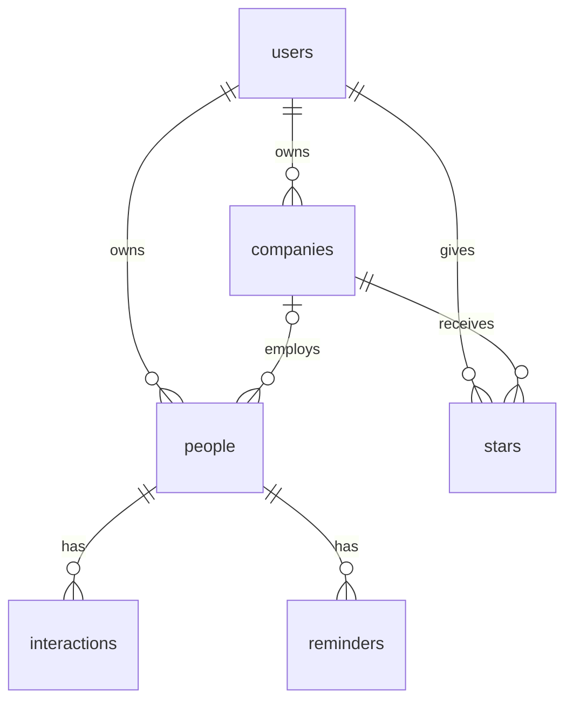

# schema.md

This is the schema I plan to build. It matches section 3 of PLAN.md.

## users
One row per account. The id is the same id as Supabase auth.users, so this table mirrors auth.

- id (text, primary key)
- email (text)
- created_at (date)

## companies
My main item. A target company on my list.

- id (number, primary key)
- user_id (text, foreign key to users)
- name (text)
- website (text)
- description (text)
- source (text)
- status (text). Allowed values: Researching, Reaching out, Applied, Interviewing, Offer, Closed.
- created_at (date)

## people
A contact. company_id is nullable, because a person doesn't need a company.

- id (number, primary key)
- user_id (text, foreign key to users)
- company_id (number, foreign key to companies, nullable)
- name (text)
- email (text)
- email_verified (true/false)
- title (text)
- how_met (text)
- tags (text, comma-separated, like "product, mba-referral")
- follow_up_date (date)

## interactions
One conversation with a person.

- id (number, primary key)
- person_id (number, foreign key to people)
- date (date)
- source (text: email, linkedin, in-person, zoom)
- summary (text)

## reminders
A follow-up on a person.

- id (number, primary key)
- person_id (number, foreign key to people)
- due_date (date)
- note (text)
- done (true/false)

## stars
One junction table for everyone. Each row means "this user starred this company." Unique on (user_id, company_id).

- id (number, primary key)
- user_id (text, foreign key to users)
- company_id (number, foreign key to companies)
- created_at (date)

## How the tables connect
One user has many companies, many people, and many stars. One company has many people, and people.company_id can be empty. One person has many interactions and many reminders. Stars is the many-to-many link between users and companies.

